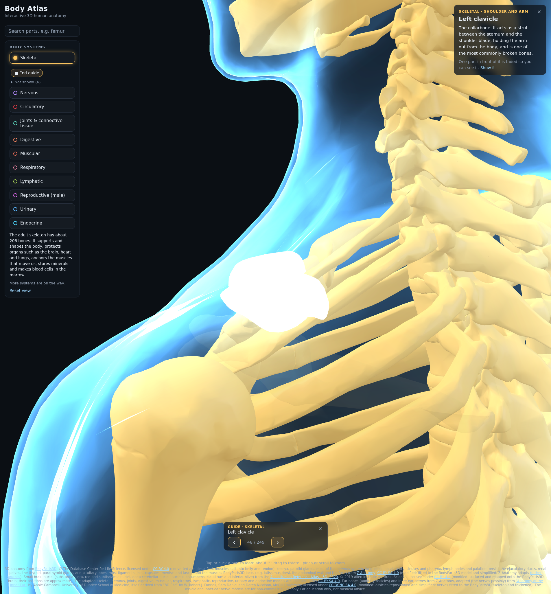

# Body Atlas

Free interactive 3D atlas of the human body with per-system highlighting.

**Live site:** https://body-atlas-hd.vercel.app

The page shows a see-through glass model of an adult male body that you can rotate, zoom and pan with a mouse or with touch. On a keyboard, W/S move forward and back, A/D slide left and right, Q/E move down and up, and holding Shift goes faster; mouse rotation then orbits around wherever you moved to. The keys do nothing while you are typing in a text field or menu, or holding Ctrl, Cmd or Alt. Turning on a body system in the filter panel lights up its parts in color. Clicking or tapping a part shows its name and a short description. Zoom in very close and parts near the camera are cut away, so you can see into bone to buried parts; parts smaller than about 1.5 cm stay whole.

It ships the **Skeletal**, **Nervous**, **Circulatory**, **Joints & connective tissue**, **Digestive**, **Muscular**, **Respiratory**, **Lymphatic**, **Reproductive (male)**, **Urinary**, **Endocrine** and **Sense organs** systems. Every bone, brain region, named nerve, artery, vein, ligament, joint capsule, cartilage pad, fascia, digestive organ, skeletal muscle, airway part, lymph node group, lymphoid organ, reproductive organ, urinary organ, endocrine gland and part of the eyes and ears in the model is a separate, clickable part with its own name and description. A system's model downloads when its filter is first switched on, except Skeletal, which loads in the background at startup.

Every system also lists what it leaves out and why (not in the free models, too small to model, shown in another system, and so on) in a "Not shown" panel under its filter, so nothing is hidden silently.

The search box above the filters finds any part by name, ignoring case and accents and allowing a typo or two; a few parts also answer to everyday names such as "kneecap" or "windpipe". Paired parts list both sides, and a part two systems show (the pancreas is in Digestive and Endocrine, say) is listed under each. Picking a part turns its system on, shows its sub-group and lowers the peel slider if they were hiding it, flies the camera to it, fades whatever stands in front of it (the info panel says how many parts and can show them again) and opens its info as a click would. Searching for a part the site leaves out, such as the substantia nigra, says it is not shown and why. Press `/` to jump to the box; ↑/↓ and Enter pick a match and Esc closes the list. While you type in it, W/A/S/D type letters instead of moving the camera.

**Stretching mode** (the button under the systems, or "How to stretch it" in a muscle's info panel, which opens it on that muscle's side) steps through every stretch on the site, head to toe, one step per variant, with ← and → (Esc ends it), then the joint and spine moves (Joints & connective tissue) and the nerve glides (Nervous). Each step shows the systems it needs (the others come back when the mode ends), poses the bones, muscles, nerves and joint parts into the stretch, lights what it works (the muscles it lengthens, the nerve it glides, the joint parts it moves) and fades the rest, and frames it. The skeleton shows on every step so you can see the joints move; the card's "Show skeleton" hides it for the rest of the mode (the Skeletal switch in the filter panel follows, and switching that also works). Its card gives the movement joint by joint, the muscles it stretches, how to do it and a cue, how long to hold it in words ("Hold 30 s, 2 times · each side"; a rolling card's "Roll for 60 s"), a Left/Right toggle and an optional end-range contract-relax. The panel on the left counts the muscles stretched so far and the steps done in each section, lists the muscles that can't be stretched and why, and has two opt-in sections: the face, eye and tongue items, which only lengthen, and 11 foam-rolling cards, each labelled with what rolling does and doesn't do (it eases soreness and briefly adds range, probably through the nervous system; it does not release fascia). Each joint move, glide and rolling card says how good the evidence for it is. A glide is a slider first, with a tensioner as a second variant for when the slider feels easy, and is never held. A step counts as done when you step past it with → or mark it. A one-side stretch is done per side: stepping past or marking it counts the side shown (the card says which sides are done and which are still to do), and the step is done once both sides are; a muscle counts as stretched once every one of its actions has been reversed on both sides. Progress is kept in the browser where it allows (localStorage) and starts over with "Start over".

Each system's filter has a **Guide** button that steps through every part of that system, head to toe, so you can read the whole system without clicking or hunting for parts. It selects the first part as a click (or a search pick) would, flying the camera to it, fading what is in front and opening its description, and a bar shows ‹ › arrows with an "n / total" count so you know nothing was skipped. The → and ← keys step forward and back and Esc (or the bar's ×, or the button again) ends it; the keys are left alone while you type in a text field, move the peel slider or hold a modifier. Paired parts come left then right, one after the other, and parts a system borrows from another (the pancreas in Endocrine, say) are included.



It is a static site with no backend, so it costs nothing to host. Vercel builds every push: pull requests get preview deployments, and `main` deploys to production at https://body-atlas-hd.vercel.app.

## Development

```sh
npm install
npm run dev       # local dev server
npm run build     # production build into dist/
npm run preview   # serve dist/ locally
```

## Project layout

| Path | What it is |
| --- | --- |
| `src/viewer.js` | three.js scene: glass shell, layer loading, hover/selection, orbit controls |
| `src/keyboard-nav.js` | WASD/QE keyboard movement: which keys are held, and `isTypingTarget`, the shared "user is typing" guard |
| `src/layers.js` | List of body-system layers and part-info lookup |
| `src/data/skeletal.json` | Skeletal layer: name, highlight color, asset, summary, and a description for every part |
| `src/data/nervous.json` | Nervous layer, including per-part colors for the brain regions and its decorative effect |
| `src/effects.js` | Decorative effects a layer can offer, such as the skin haze (not anatomy) |
| `src/data/circulatory.json` | Circulatory layer: as above, plus artery/vein/heart sub-groups, blood-flow direction, and the capillary-glow effect |
| `src/data/joints.json` | Joints & connective tissue layer: as above, plus sub-groups you can show or hide and parts shared with the Skeletal layer |
| `src/data/digestive.json` | Digestive layer: as above, plus its two decorative hazes and the "Follow the food" tour |
| `src/stepper.js`, `src/guide.js` | The reusable previous/next stepper (state, ←/→/Esc keys, its bar) and the per-system Guide that drives it: the head-to-toe part order and the Guide button |
| `src/tour.js` | A layer's guided tour: a glowing pulse that travels its parts in order, with a caption per stage |
| `src/data/muscular.json` | Muscular layer: every muscle's description, action and depth, the tendon sub-group, the exercise presets for the movement view, and the fiber-haze effect |
| `src/stretches.json`, `src/stretching.js` | Stretching data: a stretch for every muscle, as joint moves per variant, plus each muscle's actions, and the rules that read them (see "Stretching data" below) |
| `src/rig.js`, `src/pose.js`, `src/pose-view.js`, `src/cues.js` | Posing the models into a stretch (see "Stretch poses" below): the skeleton built from the bones and the skin weights of soft parts, the joint moves turned into segment turns, the skinned meshes, loop and arrows in the viewer, and the arrows for moves no bone shows |
| `src/stretch-panel.js` | "Stretch it" in a muscle's info panel: its stretches, each playing its pose, or why it can't be stretched, and the way into Stretching mode |
| `src/stretching-mode.js` | Stretching mode: every stretch head to toe on the shared stepper, the stretch card, the coverage panel and progress strip, and progress saved in the browser |
| `src/data/respiratory.json` | Respiratory layer: airway, bronchial tree, lung lobe and diaphragm descriptions in five sub-groups, and the air-sac haze |
| `src/data/lymphatic.json` | Lymphatic layer: the spleen, thymus, palatine tonsils and every lymph node group, in seven sub-groups by body region, and the "Follow the lymph" tour |
| `src/data/reproductive.json` | Reproductive (male) layer: the testes, epididymides, sperm ducts, seminal vesicles, prostate and penis, in four sub-groups |
| `src/data/urinary.json` | Urinary layer: the kidneys, renal pelves, ureters, bladder and urethra in five sub-groups, and the "Follow the urine" tour |
| `src/data/endocrine.json` | Endocrine layer: the pituitary lobes, pineal, thyroid, parathyroids and adrenals, plus the hypothalamus, thymus, pancreas and testes shared from the layers that own them, in four sub-groups |
| `src/data/senses.json` | Sense organs layer: the eyes, tear glands and ducts, eyelid plates, outer, middle and inner ears in nine sub-groups, with the eye muscles, ossicles and optic and inner-ear nerves shared from other layers |
| `src/search.js`, `src/search-ui.js`, `src/search-select.js` | Part search: the index and matching, the search box, and what picking a result does (including where the camera goes) |
| `src/mesh-names.json`, `scripts/mesh-names.mjs` | Every mesh name in each layer's models, so the search can list parts before their model loads; generated from the GLBs (`npm run mesh-names`, run by `npm run build-models`) |
| `src/not-shown.js` | The collapsible "Not shown" panel built from each layer's `notShown` list |
| `src/layer-controls.js` | Optional per-layer controls built from layer data: the peel-away depth slider and the movement picker |
| `src/main.js`, `index.html`, `src/style.css` | UI: filter panel, info panel, loading indicator, credit |
| `public/models/*.glb` | Generated, compressed models (committed) |
| `scripts/fetch-bodyparts3d.mjs` | Downloads and checksums the BodyParts3D source meshes into `.cache/` |
| `scripts/build-models.mjs` | Converts the OBJ meshes to meshopt-compressed GLB files |
| `scripts/extract-z-anatomy.py`, `data-sources/z-anatomy/` | Blender script and its output: parts BodyParts3D lacks (the coccyx, the auditory ossicles in `ossicles/`, the nervous system in `nervous/`, most ligaments, joint capsules, menisci and fasciae in `connective-tissue.obj.gz`, the lung lobes, nasal cavity, sinuses and pharynx in `respiratory.obj.gz`, and the lymph nodes and palatine tonsils in `lymphatic.obj.gz`), taken from Z-Anatomy |
| `scripts/export-z-anatomy.py`, `data-sources/z-anatomy/urinary/` | The renal pelves, with the Z-Anatomy kidneys they are placed by, exported for the Urinary layer (listed in `objects.txt`) |
| `scripts/export-z-anatomy.py`, `data-sources/z-anatomy/ear/` | The cochleae, vestibules with their semicircular canals, eardrums and auditory tubes, with the Z-Anatomy temporal bones they are placed by, exported for the Sense organs layer (listed in `objects.txt`) |
| `scripts/muscular-model.mjs` | Builds the muscles: BodyParts3D's plus the ones it lacks from Z-Anatomy (fitted onto the BodyParts3D skeleton), with each muscle's tendons split off as parts of their own |
| `scripts/export-z-anatomy.py`, `data-sources/z-anatomy/muscular/`, `data-sources/z-anatomy/reproductive/`, `data-sources/z-anatomy/endocrine/`, `data-sources/z-anatomy/circulatory/` | Blender script that exports chosen Z-Anatomy objects as OBJ files (curves as JSON polylines), the muscles it exported (listed in `objects.txt`), the ejaculatory ducts with the prostate and seminal glands used to place them, the thyroid, parathyroids and pituitary lobes with the laryngeal cartilages used to place them, and the neck vessels' curves |
| `scripts/nervous-model.mjs` | Fits the Z-Anatomy nervous system onto the BodyParts3D skeleton, keeps nerves under the skin and out of solid bone, and turns nerve curves into tubes |
| `scripts/circulatory-model.mjs` | Bridges the neck vessels BodyParts3D models in pieces (carotid, vertebral, internal jugular) with tubes along the fitted Z-Anatomy curves |
| `scripts/lymphatic-model.mjs` | Sizes the Z-Anatomy lymph nodes and moves any that the fit left in bone or outside the skin |
| `scripts/reproductive-model.mjs` | Places the Z-Anatomy ejaculatory ducts by fitting its prostate and seminal glands onto BodyParts3D's, and turns them into tubes |
| `scripts/endocrine-model.mjs` | Places the Z-Anatomy thyroid and parathyroids by fitting its thyroid and cricoid cartilages onto BodyParts3D's, and its two pituitary lobes onto BodyParts3D's pituitary |
| `scripts/settle.mjs` | Build step that moves every layer's simplified meshes under the skin, out of solid bone and out of the parts they yield to |
| `scripts/check-placement.mjs`, `scripts/placement.mjs` | Checks every layer's built model against the skin, the bones and the other layers (see "Placement check" below) |
| `scripts/passages.mjs`, `scripts/overlaps.mjs` | Where a part may lie inside a bone (real openings, attachments, known residuals) or on the skin, and where parts of different systems may overlap (nested anatomy, yields, known clipping) |

### Adding a body system

Each system is a data-driven layer, so adding another system (Muscular, say) does not touch the viewer:

1. In `scripts/build-models.mjs`, add an entry to `ASSETS` that lists its BodyParts3D element files (or a `load` function for parts from another source, as the Nervous entry does). Then rebuild the models (see below).
2. Add `src/data/<system>.json` with the same shape as `skeletal.json`: `id`, `name`, `color`, `asset`, `summary`, plus `parts` keyed by the part's name with any "left"/"right" removed.
3. Import it and append it to `LAYERS` in `src/layers.js`.
4. Fill its `notShown` list: every part of the system the model leaves out, so the site never hides anything silently. Each entry is `{ name, reason, note? }`, with `reason` one of the ids in `NOT_SHOWN_REASONS` (`src/layers.js`): `not-added` (a free model has it, the layer doesn't yet), `no-model` (not in the free models we use), `too-small`, `other-system` (add `layer: "<id>"` when another layer shows it, or `system: "<name>"` for a system the site doesn't have yet), `license` or `not-in-adult`. Check the source models before choosing a reason. The filter panel lists the entries, grouped by reason, in a collapsible "Not shown" panel under the layer's toggle. If a layer truly leaves nothing out, give it an empty list and a `nothingLeftOut` sentence saying so; `npm test` fails for a layer without a list.

A layer can also list more GLB files in `extraAssets`. They load together with `asset` and act as one layer. Skeletal and Nervous use this to keep the ossicles and the inner-ear nerves, which have a different license, in files of their own.

A part that has no entry in `parts` still shows its name when clicked. A part entry can also set its own `color` (the Nervous layer colors each brain region this way).

A layer can list decorative `effects` (see `nervous.json` and `src/effects.js`). Each one appears as a checkbox under the layer's toggle with its `label` and a `note`, which must say it is an illustrative effect and not modeled anatomy.

Optional layer fields, all generic (see `circulatory.json` for an example):

- `groups`: sub-groups with their own `label`, `color`, optional `opacity`, and optional `flow` text. The build tags each mesh with a group (`groups` in its `ASSETS` entry, stored as the `group` node extra), and the filter panel shows them as a colour key.
- `posable`: `"bones"` or `"soft"` makes the layer's parts move in stretch poses (see "Stretch poses"); a layer without it hides while a pose plays. Skeletal is `bones`; Muscular, Joints & connective tissue, Nervous and Sense organs are `soft`.
- `preload: true`: download the model in the background at startup so the first toggle is instant. Leave it off for heavy models so phones only fetch them on demand.
- `flowLabel`, plus `flow` on a group or a part: an extra line in the info panel (e.g. "Blood flow: Away from the heart").
- `effects`: optional toggles shown under the layer's button. `type: "haze"` lays a decorative glow over the skin (and over any layer with `hazeSurface: true`). `type: "part-haze"` scatters glowing specks over the layer's own parts named in `parts` (mesh names), in a `style` from `src/effects.js` (`villi`, `bacteria`, or `alveoli`, which fills the inside of closed parts instead of their surface). The UI badges every effect as "Illustrative", so describe it in `note` as a visual effect, never as modeled anatomy.
- `tour`: a "play" button under the layer's toggle that sends a glowing pulse through the layer's parts in order. It has a `label`, a `note`, a `total` shown at the end, and `stages`, each with a `name`, the `parts` (mesh names) it passes through, a `time` caption (shown as "Typical time here: …") or a free-text `caption` instead, and how many `seconds` the animation spends there. The pulse follows a part's centreline where the build stored one (`centerlines` in its `ASSETS` entry) and otherwise passes through the part's centre.
- In `scripts/build-models.mjs`, an `ASSETS` entry can also `merge` several elements into one part, `split` an element at a height into two parts, and `rename` parts (the Digestive entry does all three).
- A part whose left and right sides differ can be keyed by its full lowercase name (e.g. `"left ventricle"`), which wins over the side-less key.
- `aliases`: everyday names a part or `notShown` entry can also be searched by (e.g. `"patella"` has `["kneecap"]`).
- `"approximate": true` on a part marks one placed from a population-average atlas rather than modelled on this body (the Nervous layer's small brain nuclei). The info panel and the search results label it "Position approximate (population-average atlas)".
- `"group": "<id>"` on a part puts it in a sub-group when the build didn't tag one (`joints.json` does this).
- `groupToggles: true`: each colour-key entry becomes a checkbox that shows or hides its sub-group; a group with `visible: false` starts hidden. A see-through group (`opacity` below 1) only takes a click when no solid part is behind it.
- `depthLevels`: names of a layer's depth layers, outermost first (e.g. `["Superficial", "Intermediate", "Deep"]`). A "Peel away" slider then hides parts layer by layer; each part sets `depth` (1 = outermost). `peelReveals: "<layer id>"` offers a link to switch that layer on underneath (Muscular offers Skeletal).
- `movements`: a "Show me the muscles for…" picker (label from `movementPrompt`). Each entry is `{ id, name, note?, prime: [part keys], synergist: [part keys] }`; choosing one lights the prime movers brightest (gently pulsing unless the viewer prefers reduced motion), the synergists dimmer, and fades the rest of the layer to a ghost that clicks pass through. The selected part's info panel says its role.
- A mesh can belong to another part through the `of` node extra (a muscle's tendon names its muscle). It then takes that part's region, `flow`, `depth` and movement role, and its sub-group's `description` stands in for its own.
- An effect with `surface: "layer"` is built over the layer's own model instead of the skin; `type: "fiber-haze"` (Muscular) draws faint glowing streaks along each part.
- `shared`: a list of `{ layer, match, group? }`. It also shows another layer's meshes whose name (lowercase, "left"/"right" removed) matches the `match` regular expression as parts of this layer, reusing the other layer's model and geometry instead of shipping a copy; that layer's model loads with this one. The info panel uses this layer's `parts` entry if there is one, otherwise the other layer's. The Joints layer shares the intervertebral discs and costal cartilages this way, and the Endocrine layer the hypothalamus, thymus, pancreas and testes (so switching it on also downloads the Nervous, Lymphatic, Digestive and Reproductive models). The part search lists a shared part under both layers.

## Anatomy model: source, license and attribution

The 3D anatomy comes from **[BodyParts3D](https://dbarchive.biosciencedbc.jp/en/bodyparts3d/)**, © The Database Center for Life Science (DBCLS). BodyParts3D is a set of 3D models built from scans of a single adult Japanese male, with one mesh per anatomical structure.

- **License:** [Creative Commons Attribution 4.0 International (CC BY 4.0)](https://creativecommons.org/licenses/by/4.0/), per the [official license page](https://dbarchive.biosciencedbc.jp/en/bodyparts3d/lic.html) (updated 2025-02-27). The OBJ files still carry a header from an older release that names CC BY-SA 2.1 Japan; the database's current license page supersedes that header.
- **Required credit:** "BodyParts3D, © The Database Center for Life Science licensed under CC Attribution 4.0 International". The site shows this in its footer, with links to the source and the license.
- **Changes made:** the meshes were converted from OBJ to glTF, rescaled to metres, re-oriented to Y-up, simplified, and compressed with meshopt. A few parts were renamed (see `NAME_OVERRIDES` in `scripts/build-models.mjs`). In the circulatory model, elements that share a name (e.g. the segments of one vein) were merged into one part, and same-named vessels on both sides of the body were split into left and right; the neck vessels it models in pieces were joined up from Z-Anatomy (see below). In the respiratory model, the pieces of each segmental bronchial tree were merged into one part. In the digestive model, the pieces of the liver, pharynx, bile ducts, jejunum and ileum were merged into one part each, and the cecum and sigmoid colon were cut off the ascending and descending colon at an approximate boundary. In the nervous model, the two halves of the hypothalamus were merged and the corpus callosum's loose fragments dropped. In the muscular model, one-sided muscles were mirrored to the other side, each muscle's tendons were split off into a separate part, and a few parts were renamed (see `scripts/muscular-model.mjs`). In the endocrine model, the pineal body is named "Pineal gland", and the pituitary gland is used only to place Z-Anatomy's two pituitary lobes, which are shown instead. The external ear, one element for both ears, was cut at the midline into a left and a right auricle, and is also merged into the skin shell, which BodyParts3D models without ears; the two pieces of each choroid were merged, a few scraps of the left eye were dropped from the right sclera and choroid, and the optic part of the retina and the corona ciliaris are shown as the retina and the ciliary body.
- **Source files used:** `isa_BP3D_4.0_obj_99.zip` (polygon reduction rate 99%, IS-A tree) and the element lists `isa_element_parts.txt` and `partof_element_parts.txt`, which say which elements are arteries, veins or parts of the heart, BodyParts3D version 4.0.

The **coccyx**, which BodyParts3D lacks, comes from **[Z-Anatomy](https://www.z-anatomy.com)** ([source repository](https://github.com/Z-Anatomy/Models-of-human-anatomy)), "Z-Anatomy - The libre 3D atlas of anatomy", licensed [CC BY-SA 4.0](https://creativecommons.org/licenses/by-sa/4.0/). Z-Anatomy is itself derived from BodyParts3D and shares its scale. `scripts/extract-z-anatomy.py` extracts the mesh from Z-Anatomy's Blender template into `data-sources/z-anatomy/coccyx.obj`. The build then moves it so that it sits under the BodyParts3D sacrum.

The six **auditory ossicles** (malleus, incus and stapes of each ear) also come from Z-Anatomy, which adapted them from **[“Anatomy of the Inner Ear”](https://sketchfab.com/3d-models/anatomy-of-the-inner-ear-f80bda64666c4b8aaac8f63b7b82a0a0)** by Annie Campbell, University of Dundee School of Medicine ([AnatomyTOOL record](https://anatomytool.org/node/60505)). That model is itself a derivative of “3D Ear” by W. Robert J. Funnell, PhD, Sam Daniel, MD, CM and Daren Nicolson, MD, CM at McGill University. It is licensed [CC BY-NC-SA 4.0](https://creativecommons.org/licenses/by-nc-sa/4.0/), which allows **non-commercial use only**. `scripts/extract-z-anatomy.py` extracts the six meshes into `data-sources/z-anatomy/ossicles/`, and the build moves each one into place by matching the centre of its temporal bone, then simplifies it.

So that the restriction stays with those files only, the ossicles ship separately: **`public/models/skeletal-ossicles.glb` and `data-sources/z-anatomy/ossicles/` are distributed under CC BY-NC-SA 4.0 and may not be used commercially.** The same holds for the Sense organs layer's ear parts: **`public/models/senses-ear.glb` and the cochlea, vestibule, tympanic membrane and auditory tube files in `data-sources/z-anatomy/ear/` are distributed under CC BY-NC-SA 4.0 and may not be used commercially** (their file headers say so; the temporal bones there are CC BY-SA 4.0). Body Atlas is a free, non-commercial site. The footer credits Dundee, McGill and Z-Anatomy, notes the changes and states that the ossicle and ear models are non-commercial.

Most of the **nervous system** also comes from Z-Anatomy, because BodyParts3D has no spinal cord or peripheral nerves. The extract script exports the brain regions (each lobe is Z-Anatomy's gyri and sulci for it merged into one mesh), the falx cerebri, tentorium cerebelli and septum pellucidum, the spinal cord, ganglia and optic pathway as meshes, and the nerves, which Z-Anatomy draws as curves, as sampled polylines. `scripts/nervous-model.mjs` then fits it onto the BodyParts3D skeleton, bone by bone, and turns each nerve into a thickened tube so it reads as a glowing thread.

The **deep brain structures** come from BodyParts3D, which models them as separate meshes in its own head: the thalamus, hypothalamus and mammillary bodies, caudate nucleus, putamen and globus pallidus, hippocampus and amygdala, corpus callosum, internal capsule, fornix and the anterior and posterior commissures, the ventricles, cerebral aqueduct and interventricular foramen, and the choroid plexus (`DEEP_BRAIN` in `scripts/build-models.mjs`). The Z-Anatomy brain is fitted onto the BodyParts3D skull, and the two cortices agree to within about 2 mm, so these meshes are used where BodyParts3D puts them. How they were changed is listed under "Changes made" above.

The **small brain nuclei** that neither BodyParts3D nor Z-Anatomy models, the substantia nigra, red and subthalamic nuclei, deep cerebellar nuclei, nucleus accumbens, claustrum and inferior olive, come from the **[Allen Human Reference Atlas – 3D, 2020](https://download.alleninstitute.org/informatics-archive/allen_human_reference_atlas_3d_2020/version_1/)** (Ding et al.; RRID:SCR_017764), © 2019 Allen Institute for Brain Science, licensed [CC BY 4.0](https://creativecommons.org/licenses/by/4.0/). The atlas is a 0.5 mm label volume of a population-average brain (MNI ICBM 2009b), not of the BodyParts3D body, and it labels the four deep cerebellar nuclei together, so they are one part per side. `npm run fetch-data` downloads the volume and its structure list into `.cache/allen/` (`scripts/fetch-allen.mjs`), and `scripts/allen-model.mjs` surfaces each nucleus from its labels and maps it onto the shown brain: an affine fitted to the centres of structures both have (the thalamus, basal ganglia, hippocampus, amygdala, ventricles and hypothalamus), then a smooth warp that fits those structures, the insula, brainstem and cerebellum onto the shown ones, and last a small move so each nucleus lies inside the part that holds it (the substantia nigra, red nucleus and inferior olive in the brainstem, the deep cerebellar nuclei in the cerebellum) and clear of its neighbours. That puts them where the atlas has them relative to the structures around them, to within a few millimetres, so the site labels them "Position approximate (population-average atlas)". The footer credits the Allen Institute and notes the changes.

Z-Anatomy lists these models as used for reference or included and adapted, so parts of its brain and cranial nerves may derive from them: "Brainder" and "White matter" from the University of Washington; and "Cranial Nerves and Foramina" by the University of Dundee, CAHID (CC BY 4.0).

Most **ligaments, joint capsules, menisci, joint discs and fasciae** come from Z-Anatomy too, because BodyParts3D has only a few of them (the interosseous membranes, the wrist's flexor retinaculum, the iliotibial tract, the long plantar ligament and the ligaments and membranes of the larynx and hyoid, which are taken from BodyParts3D). `scripts/extract-z-anatomy.py` writes them to `data-sources/z-anatomy/connective-tissue.obj.gz`, already moved onto the BodyParts3D skeleton: Z-Anatomy's bones were reshaped from BodyParts3D's and sit up to about 2 cm away from them, so the script registers each Z-Anatomy bone onto its BodyParts3D twin (long bones piece by piece) and moves every vertex of a ligament or fascia with the bones nearest to it. It also decimates the largest sheets, and the build simplifies them further.

The **lung lobes, nasal cavity, paranasal sinuses** (frontal, sphenoidal and the anterior, middle and posterior ethmoidal cells) and the **nasopharynx, oropharynx and laryngopharynx** come from Z-Anatomy too, because BodyParts3D has the trachea, bronchial tree and laryngeal cartilages but not these. `scripts/extract-z-anatomy.py` writes them to `data-sources/z-anatomy/respiratory.obj.gz`, moved onto the BodyParts3D skeleton the same way as the connective tissue.

The **lymph nodes** and the two **palatine tonsils** come from Z-Anatomy too, because BodyParts3D has only the spleen and the thymus (which are taken from it). `scripts/extract-z-anatomy.py` writes every mesh in Z-Anatomy's lymphoid-organs collection to `data-sources/z-anatomy/lymphatic.obj.gz`, moved onto the BodyParts3D skeleton the same way as the connective tissue and tagged with its body region. The build (`scripts/lymphatic-model.mjs`) then draws each node at least 6 mm across, closer to a typical node's size than Z-Anatomy's 2.5 mm spheres, and moves any node left in bone or outside the skin out of it as a whole.

The two **ejaculatory ducts** come from Z-Anatomy too, because BodyParts3D has the rest of the male reproductive organs (the testes, epididymides, deferent ducts, seminal vesicles, prostate, corpora cavernosa, corpus spongiosum and glans) but not these. Z-Anatomy draws them as curves. `scripts/export-z-anatomy.py` writes them, with Z-Anatomy's prostate and seminal glands, to `data-sources/z-anatomy/reproductive/`; `scripts/reproductive-model.mjs` fits those glands rigidly onto the BodyParts3D prostate and seminal vesicles (about 1 mm RMS), moves the ducts with that fit and turns each into a tube.

The **renal pelvis** of each kidney, with its calyces, comes from Z-Anatomy too, because BodyParts3D has the kidneys, ureters, bladder and urethra (which are taken from it) but not the space inside the kidney where urine collects. `scripts/export-z-anatomy.py` exports them with Z-Anatomy's kidneys into `data-sources/z-anatomy/urinary/`. Z-Anatomy's kidneys are BodyParts3D's, moved elsewhere in one piece, so the build moves each pelvis by the offset that puts its Z-Anatomy kidney back onto the BodyParts3D one (`renalPelves` in `scripts/build-models.mjs`).

The middle stretch of the main **neck vessels** comes from Z-Anatomy too, because BodyParts3D models them in pieces: its common carotid arteries stop about 6 cm below the start of its internal carotids, its vertebral arteries start about 5 cm above the subclavian arteries they branch from, and its internal jugular veins stop low in the neck. Z-Anatomy draws these vessels whole, as curves. `scripts/export-z-anatomy.py` writes its common and internal carotid arteries, vertebral arteries and internal jugular veins to `data-sources/z-anatomy/circulatory/`, and `scripts/circulatory-model.mjs` moves them onto the BodyParts3D skeleton with the nervous system's bone-by-bone fit and turns the stretch BodyParts3D lacks into a tube that continues the BodyParts3D vessel at each end (pinned to its cut end, in its direction and at its width). The bridge below the carotid bifurcation joins the common carotid and the rest the internal carotid, and the internal jugular runs up to the skull base, where it leaves the jugular foramen. `scripts/circulatory-layer.test.mjs` checks that these vessels stay continuous.

The **thyroid gland**, the four **parathyroid glands** and the pituitary's **anterior and posterior lobes** come from Z-Anatomy too, because BodyParts3D has no thyroid or parathyroids and models the pituitary as one mesh. `scripts/export-z-anatomy.py` writes them, with Z-Anatomy's thyroid and cricoid cartilages, to `data-sources/z-anatomy/endocrine/`; `scripts/endocrine-model.mjs` fits those cartilages rigidly onto BodyParts3D's (about 0.8 mm RMS) and moves the thyroid and parathyroids with that fit, and fits the two pituitary lobes together onto BodyParts3D's pituitary (about 0.3 mm RMS), which they replace. BodyParts3D's own pineal body (shown as "Pineal gland") and adrenal glands are used as they are.

The **cochlea**, the **vestibule** with its three semicircular canals (one mesh in Z-Anatomy), the **eardrum** (tympanic membrane) and the **auditory tube** of each ear come from Z-Anatomy too, because BodyParts3D has the eyes, tear ducts and outer ears (which are taken from it) but not the middle and inner ear. `scripts/export-z-anatomy.py` exports them with Z-Anatomy's temporal bones into `data-sources/z-anatomy/ear/`, and the build moves each one by the offset that puts the centre of its Z-Anatomy temporal bone on the BodyParts3D one's, as for the ossicles (`earParts` in `scripts/build-models.mjs`), so the stapes still sits in the vestibule's oval window. Z-Anatomy adapted them, or may have adapted them, from Dundee's “Anatomy of the Inner Ear” like the ossicles, so they ship under its license (see below).

The two **parotid glands** come from Z-Anatomy as well, because BodyParts3D has the other salivary glands but not these. `scripts/extract-z-anatomy.py` extracts them into `data-sources/z-anatomy/parotid-gland-left.obj` and `parotid-gland-right.obj`, and the build moves each one so that the submandibular gland next to it lines up with the BodyParts3D one.

The **muscles** come from BodyParts3D: every element its IS-A tree files as a muscle, a head or a part of one, plus the muscle sets, trapezius parts and free-standing tendons listed in `scripts/muscular-model.mjs`. Paired muscles BodyParts3D models on one side only are mirrored to the other. The muscles BodyParts3D lacks (latissimus dorsi, rectus abdominis, the internal oblique and transversus abdominis, quadratus lumborum, the muscles of facial expression and of chewing, multifidus, and a few in the foot) come from Z-Anatomy: `scripts/export-z-anatomy.py` exports them to `data-sources/z-anatomy/muscular/`, and the build fits them onto the BodyParts3D skeleton with the same bone-by-bone warp as the nervous system. The build then splits each muscle's tendons off as separate parts: stretches of the mesh much thinner than the muscle's belly that reach a bone. That split is an approximation from the shape alone; muscles that end in skin, fascia or other muscles (such as the face's) are left whole. Each muscle's depth for the peel-away slider and its role in each exercise are this project's own simplified grouping.

Because of those ShareAlike parts, **`public/models/skeletal.glb`, `public/models/circulatory.glb`, `public/models/nervous.glb`, `public/models/joints.glb`, `public/models/digestive.glb`, `public/models/muscular.glb`, `public/models/respiratory.glb`, `public/models/lymphatic.glb`, `public/models/reproductive.glb`, `public/models/urinary.glb`, `public/models/endocrine.glb` and `data-sources/z-anatomy/` (apart from `ossicles/`, the ear parts in `ear/` and the inner-ear nerve entries in `nervous/nerves.json`) are distributed under CC BY-SA 4.0**. `public/models/skin.glb` and `public/models/senses.glb` are under CC BY 4.0. The Allen atlas nuclei in `nervous.glb` are CC BY 4.0 material included in it. The site credits these sources in its footer, notes that the Z-Anatomy parts were modified, and states that the skeletal, circulatory, nervous, joints, digestive, muscular, respiratory, lymphatic, reproductive, urinary and endocrine models are CC BY-SA 4.0.

The **inner-ear nerves** (the cochlear, vestibular and vestibulocochlear (VIII) nerves and the chorda tympani of each side) also come from Z-Anatomy, which may have adapted them from **[“Anatomy of the Inner Ear”](https://sketchfab.com/3d-models/anatomy-of-the-inner-ear-f80bda64666c4b8aaac8f63b7b82a0a0)** by Annie Campbell, University of Dundee School of Medicine. That model is itself a derivative of “3D Ear” by W. Robert J. Funnell, PhD, Sam Daniel, MD, CM and Daren Nicolson, MD, CM at McGill University. It is licensed [CC BY-NC-SA 4.0](https://creativecommons.org/licenses/by-nc-sa/4.0/), which allows **non-commercial use only**. So that the restriction stays with those parts only, they ship separately: **`public/models/nervous-inner-ear.glb` and the inner-ear nerve entries in `data-sources/z-anatomy/nervous/nerves.json` (Cochlear nerve, Vestibular nerve, Vestibulocochlear nerve (VIII) and Chorda tympani, both sides) are distributed under CC BY-NC-SA 4.0 and may not be used commercially.** Body Atlas is a free, non-commercial site. The footer credits Dundee, McGill and Z-Anatomy, notes the changes and states that the inner-ear nerve model is non-commercial.

The part descriptions in `src/data/` are original text written for this project.

### Rebuilding the models

```sh
npm run fetch-data     # downloads ~142 MB (BodyParts3D and the Allen brain atlas) into .cache/ (gitignored) and checks their SHA-256
npm run build-models   # writes public/models/skin.glb, skeletal.glb, skeletal-ossicles.glb, circulatory.glb, joints.glb, muscular.glb, digestive.glb, respiratory.glb, lymphatic.glb, urinary.glb, nervous.glb, nervous-inner-ear.glb, reproductive.glb, endocrine.glb, senses.glb and senses-ear.glb, then src/mesh-names.json, then runs the placement check
npm run check-placement   # the placement check on its own (a few minutes)
```

The generated GLB files come to about 22.4 MB in total (circulatory.glb is about 4.8 MB, muscular.glb about 4.3 MB, digestive.glb about 1.5 MB, joints.glb about 1.4 MB, respiratory.glb about 1.2 MB, lymphatic.glb about 0.9 MB, urinary.glb, reproductive.glb and endocrine.glb under 0.1 MB each); each system's file downloads only when its filter is first turned on. They are committed, so a normal build does not need the source data.

`data-sources/z-anatomy/` is committed too. To regenerate it, run `npm run fetch-data` (the registration needs the BodyParts3D meshes), download `Z-Anatomy.zip` from the Z-Anatomy repository, unzip it, and run its `Startup.blend` through Blender 4.x or later (it needs about 9 GB of memory and a few minutes):

```sh
blender -b --factory-startup --disable-autoexec Z-Anatomy/Startup.blend \
  --python scripts/extract-z-anatomy.py -- data-sources/z-anatomy .cache/bodyparts3d/obj
```

The Z-Anatomy muscles in `data-sources/z-anatomy/muscular/`, the ejaculatory ducts in `data-sources/z-anatomy/reproductive/`, the renal pelves and kidneys in `data-sources/z-anatomy/urinary/` (listed in its `objects.txt`), the endocrine glands in `data-sources/z-anatomy/endocrine/`, the neck vessels in `data-sources/z-anatomy/circulatory/` and the ear parts and temporal bones in `data-sources/z-anatomy/ear/` come from a lighter export that loads only the objects it is given (a few GB of memory):

```sh
blender -b --factory-startup --disable-autoexec --python scripts/export-z-anatomy.py -- \
  Z-Anatomy/Startup.blend data-sources/z-anatomy "names:muscular=data-sources/z-anatomy/muscular/objects.txt" \
  'objects:reproductive=^(Prostate|Seminal gland\.[lr]|Ejaculatory duct\.[lr])$' \
  "names:urinary=data-sources/z-anatomy/urinary/objects.txt" "names:ear=data-sources/z-anatomy/ear/objects.txt" \
  'objects:endocrine=^(Adenohypophysis|Neurohypophysis|Thyroid gland|(Superior|Inferior) parathyroid gland\.[lr]|Thyroid cartilage|Cricoid cartilage)$' \
  'objects:circulatory=^((Internal carotid artery|Internal jugular vein|Vertebral artery)\.[lr]|(Right|Left) common carotid artery)$'
```

### Placement check

`npm run check-placement` (also run at the end of `npm run build-models`, and in CI on every pull request by `.github/workflows/check.yml`) checks every layer listed in `src/data/`, so a new layer is covered without being registered anywhere:

1. **Nothing outside the skin.** Every triangle edge of every part, bones included, is sampled; none may stick out of the skin shell by more than 0.3 mm, except a part whose own surface is the skin's (`ON_SKIN` in `scripts/passages.mjs`: the outer ears, up to 1 mm).
2. **Nothing through solid bone.** BodyParts3D's simplified bones are solid, so a part may lie inside one only where it really does, as listed in `PASSAGES` in `scripts/passages.mjs`, each entry named and bounded by how deep it may run: nerves in their foramina and canals, teeth in their sockets, the sinuses in their bones, the nasal cavity around its conchae, the inner and middle ear in the temporal bone, and muscles, tendons, ligaments, capsules and fasciae up to 3 mm where they attach. Everything else may graze bone by 1.5 mm at most (lymph nodes, which sit in fat, 1 mm). The Skeletal layer is the reference and is only checked against the skin.
3. **Systems not running deep into each other.** Each vertex of a part is tested against the closed parts of the other layers. Overlap up to 3 mm is contact; up to 6 mm is listed but allowed; deeper fails, unless one part really lies inside the other (`NESTED` in `scripts/overlaps.mjs`: the bronchial and pulmonary vessels in the lungs, the hepatic vessels in the liver, the tongue's muscles and nerves in the tongue, the cerebral vessels in the brain's sulci, fascia between muscles, and so on, each bounded). Overlaps within one layer (a branch leaving its parent vessel, a tooth in its gum) are that layer's own modelling and are not checked.

The build fixes what it can before the check runs. `scripts/settle.mjs` moves each layer's simplified meshes the way `nervous-model.mjs` fits the nerves: vertices outside the skin or too deep in bone move just far enough, the move fades out over the surrounding surface, and edges that still cut through a bone are split so their middle can move too. Moved vertex by vertex, a thin vessel lying on a bone gets a different move on each side and crumples, so the Circulatory layer (its asset's `smooth` option) is first moved by a smooth field instead: each bad point pulls the vessel's vertices within up to 40 mm toward its fix, from wide pulls down to fine ones, so a vessel's cross-section moves as one and the vessel bends instead of crumpling; a vessel in a bone it has no opening into goes back only to within the 1.5 mm tolerance, and only what the field leaves wrong is moved vertex by vertex. `scripts/circulatory-shape.test.mjs` fails if the vessels lying on bone, or the model as a whole, fold back on themselves. Parts also move out of the parts they must yield to (`YIELDS` in `scripts/overlaps.mjs`): the gut out of the abdominal wall muscles, the lungs off the diaphragm and chest wall, and the nerves out of the gut, the urinary organs and the great vessels, and the optic nerves out of the eyeballs. So that each part can yield to parts already built, the build makes the organs after the muscles and the nerves last. (`scripts/lymphatic-model.mjs` first moves each lymph node out of bone and skin whole, so it keeps its shape.)

What the build could not fix is listed rather than hidden, each entry with its reason and bounded by how deep it runs now so it cannot grow: `RESIDUALS` in `scripts/passages.mjs` (mostly muscles and ligaments left 0.5 to 2.5 mm deeper than the attachment allowance, named by part and bone, such as the deep back muscles and interspinous ligaments between the vertebrae, and a few deeper cases that BodyParts3D's own source meshes overlap, such as the adductor magnus in the femur), `SKIN_RESIDUALS` there (the temporoparietalis muscles and the left pre-auricular nodes, under 1 mm out of the sharp fold where the shell's outer ear joins the head) and `KNOWN` in `scripts/overlaps.mjs` (mostly BodyParts3D organs that already overlap in the source, such as the stomach and liver, organs pressed into Z-Anatomy's fascia sheets, which are open and cannot be yielded to, and the Lymphatic layer's lymph node clusters pressed into the organs they drain). The check prints all of them. A new layer, or a change that makes any of them deeper, fails.

### Skeletal coverage

The Skeletal layer covers all 206 bones of the standard adult count, including the 6 auditory ossicles. It also includes the 4 sesamoid bones under the big toes, the costal cartilages and the intervertebral discs. The sternum is shown as its three parts: manubrium, body and xiphoid process.

The ossicles sit inside the temporal bone, in the middle ear. Only the malleus can be seen through the ear canal. The incus and stapes sit deeper inside the temporal bone. To see them, zoom toward the ear until the bone in front is cut away.

### Nervous coverage

The Nervous layer shows the brain split into regions (the frontal, parietal, temporal and occipital lobes, insula and limbic lobe of each hemisphere, plus the cerebellum and brainstem, each in its own color), the optic chiasm and tracts, the spinal cord and cauda equina, the spinal nerve roots and ganglia, the sympathetic trunks, and every named nerve in Z-Anatomy's peripheral nervous system: the 12 pairs of cranial nerves and their main branches, the brachial, lumbar and sacral plexuses and the nerves of the arms, trunk and legs.

Inside the brain it shows the deep structures: the thalamus, hypothalamus and mammillary bodies, the basal ganglia (caudate nucleus, putamen, globus pallidus), hippocampus and amygdala, the corpus callosum, internal capsule, fornix, commissures and septum pellucidum, and the ventricles with the choroid plexus. Smaller nuclei mapped from a brain atlas sit among them: the substantia nigra, red nucleus and inferior olive in the brainstem, the deep cerebellar nuclei in the cerebellum, and the subthalamic nucleus, nucleus accumbens and claustrum; their positions are approximate, and the page says so. The falx cerebri and tentorium cerebelli, the folds of the dura mater, sit between the hemispheres and over the cerebellum. **Peel away** hides the brain surface (lobes, cerebellum and dura folds), then the deep white matter, then the deep grey matter, down to the ventricles and the brainstem with its nuclei.

The thalamus's separate nuclei, the four deep cerebellar nuclei told apart, and the many small unnamed nerve twigs are not shown; the layer's "Not shown" list names them. Nerves are drawn thicker than life so they stay visible.

The optional **nerve-ending haze** is a decorative effect, not anatomy: twinkling specks just under the skin, denser at the fingertips, lips, face and soles to suggest where sensory endings are most concentrated. The page labels it as an illustrative effect.

### Circulatory coverage

The Circulatory layer shows every artery and vein that BodyParts3D models as its own named element: 438 artery parts and 224 vein parts after merging same-named segments, from the aorta down to the digital arteries of the fingers and toes. BodyParts3D models the carotid, vertebral and internal jugular vessels of the neck in pieces, so their missing middle stretches are filled in from Z-Anatomy (see "Anatomy model" above) and each runs continuously from the chest to the skull. BodyParts3D has no external carotid artery or its branches to the face and scalp, so the common carotid runs straight on into the internal carotid; the layer's "Not shown" list says so. Each part's info panel says whether it carries blood toward or away from the heart (and, for the pulmonary vessels, that their oxygen levels are the reverse of the rest of the body's). Arteries are red and veins blue.

The heart is split into its four chambers (the blood-filled cavities), the walls of the atria and ventricles, and the valve apparatus: the cusps of the aortic and pulmonary valves, the leaflets of the mitral and tricuspid valves, and the papillary muscles. The walls and chambers are see-through so the valves show inside.

Capillaries are far too small and numerous to model, so they are not shown. The optional **Capillary glow** toggle lays a soft, pulsing glow over the skin as a hint of the capillary beds. It is a decorative visual effect, not modeled anatomy, and the filter panel labels it "Illustrative".

### Muscular coverage

The Muscular layer shows every skeletal muscle in the model: about 245 named muscles and muscle parts, most of them on both sides (the deltoid, trapezius and pectoralis major in their parts, the biceps, triceps and gastrocnemius by head), from the muscles of the face, eye, tongue, throat and larynx to those of the fingers and toes. Each one's info panel gives its name, a short description and its action (the movement it makes). Cardiac muscle and the smooth muscle of the organs belong to other systems and are not part of this layer.

- **Tendons** are paler parts of their own, showing where each muscle attaches to bone; clicking one shows which muscle it belongs to. The colour key's checkboxes show or hide the muscles and the tendons. Ligaments are in the Joints & connective tissue layer.
- **Stretch it**, in a muscle's info panel, lists the stretches that lengthen it (or says why it can't be stretched) and plays each one on the model (see "Stretch poses").
- **Peel away** hides the superficial muscles, then the intermediate ones, then the deep ones, down to bone, and offers to switch the Skeletal layer on underneath.
- **Show me the muscles for…** picks an exercise (squat, lunge, deadlift, glute bridge, calf raise, push-up, bench press, overhead press, pull-up, bent-over row, bicep curl, triceps dip, plank or crunch) and lights up the muscles that do the work: prime movers brightest, synergists dimmer. The lists follow common exercise-science descriptions and are simplified.
- The optional **Muscle-fiber haze** is a decorative effect, not anatomy: faint glowing streaks drift along each muscle's long axis, not its real fibre directions. The page labels it as an illustrative effect.

### Stretching data

`src/stretches.json` holds every stretch, written as data so a test can prove nothing is missed. A muscle's info panel already offers its stretches ("Stretch it"); the rest of the stretching work is listed in "Stretching: delivered and upcoming" below. Read the data only through `src/stretching.js`.

- `stretches`: each has an `id` (e.g. `P1`), a `name`, a head-to-toe `group`, a `kind` (`stretch` through a joint, `lengthen` for an opposite movement with no proven stretch effect, `joint` for a joint or spine mobility move, `glide` for a nerve glide, `roll` for a foam-rolling card), a `position`, `how`, an optional `cue`, a `hold` (per side when `sided`; the card says it in words through `holdText`, so "30 s x 2" reads "Hold 30 s, 2 times"), `sided` when it is done one side at a time (a variant can override it; read it through `isSided`), `contractRelax` when an end-range contract-relax suits it, `optIn` naming its opt-in section (`OPT_IN`: `lengthen` for the face, eye and tongue items, `rolling` for foam rolling), and one or more `variants` (`a`, `b`…). A `joint`, `glide` or `roll` item also has its home `layer` (`joints` or `nervous`), an `evidence` note for its card, and `parts`: the part keys it works, by layer (`{ "nervous": ["median nerve"] }`; a variant may give its own). It counts toward no muscle's stretches, and a rolling card has no moves (the model can't lie on a roller). A variant is a `label`, its `moves` and, optionally, `setup` moves that hold the limb where the stretch is done (the doorway stretch's bent elbow) and count for nothing in the coverage check. A variant is one pose: it never moves a joint both ways, and the shin only rotates with the knee bent. A non-sided variant that turns a midline part or the eyes one way ("turn the head to the left") is written for the left side; `movesFor` mirrors it for the right, so each such pose is shown once and the coverage check needs both directions.
- A move or action is `"<joint>.<direction>"`, e.g. `"hip.flex"`, optionally with an angle (`"hip.flex:80"`). Directions are relative to the muscle's own side (`sbi` = side-bend toward it, `rotc` = turn away from it); `OPPOSITE` in `src/stretching.js` lists them. `joints` names each joint and gives its normal range in degrees where a source does (AAOS, see `sources`).
- `muscles`, keyed like the Muscular layer's `parts`: a stretchable muscle lists its `actions` and the `stretches` (variant refs such as `P1a`, or `P1` for every variant) that lengthen it; a `lengthenOnly` one lists only `stretches`; one that can't be stretched gives the reason in `cannot`.
- A move without an angle is posed to the joint's normal range (`rom`) or, failing that, to `DEFAULT_ANGLE` in `src/pose.js`; give it one (`"hip.flex:80"`) when several moves at one joint would otherwise add up past a natural pose.
- `npm test` (`scripts/stretches.test.mjs`) fails unless every Muscular part has an entry and every action of a stretchable muscle is reversed (the opposite direction at the same joint) by a move of one of its own stretches. When you add or change a muscle, add or update its entry.

### Stretch poses

"Stretch it" plays a variant on the model itself: the bones and muscles (and any nerves or joint parts shown) move into the stretch and back on a loop (held still for viewers who prefer reduced motion), the muscles it stretches light up, and a curved arrow at each moving joint shows the way it turns (the jaw's runs through the chin, and its forward or back glide is a straight arrow). Moves no bone can show, the "Lengthen it" items among them, get straight arrows at the muscles that make them: the ribs out and the diaphragm down for a breath in, the pelvic floor dropping, the tongue reaching out, the brows rising, the eyelids closing. The eye moves are posed: both eyeballs turn together about their own centres (each eye is a rig segment placed at its sclera once the Sense organs load, which Stretching mode does for an eye step), the eye muscles stretching and shortening with them, and a straight arrow in front of each eye shows where they look. The glass skin does not move, so it stays as a ghost of the starting position. Systems that are not posable, and decorative effects laid over a layer, hide while a pose plays.

- The models have no skeleton of their own, so `src/rig.js` builds one from the bones when the Skeletal model loads. Each segment (pelvis, lumbar and thoracic spine, two neck segments, head, jaw, and per side the shoulder girdle, upper arm, forearm, a forearm twist, hand, thumb and finger phalanges, thigh, shank, foot and toe phalanges) owns the bones in it and turns about a pivot found from their shape: the femoral and humeral heads by a sphere fit, the elbow above the end of the humerus, the knee at the femoral condyles, the ankle between the malleoli, each knuckle at its bone's head.
- A layer with `"posable": "bones"` (Skeletal) loads its meshes bound rigidly to their segment; one with `"posable": "soft"` (Muscular, Joints & connective tissue, Nervous, Sense organs) loads them on the same skeleton, and the first pose that could move a part gives it skin weights: each vertex follows its nearest bone within its region's segments (`REGION_FAMILIES`), blended across the joint, so a muscle that crosses a joint bends with it. While nothing is posed, these skinned meshes draw, bound and pick exactly like plain meshes. While posed, they are picked where they are drawn without skinning every vertex on the CPU for each pick (hover picks every frame): a part whose bones the pose moves alike is picked as a rigid mesh, and only one bent across a moving joint is skinned, once per frame, when the ray comes near it.
- `src/pose.js` turns each move into segment turns (`DIRECTIONS`: hip flexion takes the thigh's direction toward the front, pronation turns the palm toward the midline…). Turns at one joint compose in the joint coordinate system's order (rotation about the segment's length, then side-to-side, then front-back), so a flexed thigh can still swing out. A variant done with both limbs at once (the butterfly, child's pose) moves both alike. The forearm rests palm forward, already past thumb-forward: pronation turns from there, and supination starts from thumb-forward and turns palm-up into the stretch, so the hand visibly turns. Joints with no bone to turn (the ribs, face, eyes, tongue, palm, foot arch, hyoid and pelvic floor) are left unposed; `src/cues.js` (`CUES`) gives each of their moves its arrows instead: the muscles they start at, the segment they ride on (so they follow the pose) and the way they point.
- `npm test` (`scripts/pose.test.mjs`) checks the pivots against the bones and between the sides, that each direction turns the right way, that every variant poses on both sides within the joints' normal ranges, and that a posed part moves, bends at its joint and is picked where it is drawn (the same hits as three.js's per-vertex skinned raycast).

### Stretching: delivered and upcoming

The stretching work ships in stages. Delivered so far:

- The stretch data for every Muscular part (see "Stretching data"): a stretch for every action of every stretchable muscle, the lengthen-only items labelled as such, and the muscles that can't be stretched listed with a reason.
- "Stretch it" in a muscle's info panel, with How, Hold and Cue, playing each variant as a pose of the bones and muscles with an arrow at each moving joint, forearm rotation included (see "Stretch poses"). It plays on the selected muscle's side, or on both limbs for a stretch done with both at once, and lights the muscles each variant lengthens on the side it lengthens them (`stretchedSides`: turning the head left lights the right splenius).
- **Stretching mode** (see the top of this README): every stretch, head to toe, one step per variant with a Left/Right toggle, the hold in words, the skeleton shown (with "Show skeleton" to hide it), the optional end-range contract-relax on the stretches marked `contractRelax`, coverage by muscle and section, the can't-be-stretched list, and the face, eye and tongue lengthen-only items (`optIn`) as an opt-in section. `npm test` (`scripts/stretching-mode.test.mjs`) checks the card's words for every move, the coverage counts, the lit sides and the saved progress.
- Joint and spine moves (Joints & connective tissue): inferior shoulder glide, thoracic extension over a roller, open-book thoracic rotation, cat-camel, hip long-axis distraction, hip rock-back, the ankle glide with knee-to-wall, and controlled joint circles (CARs) for the shoulder and hip. The trunk's muscle stretches stay in Muscular; the mode runs both.
- Nerve glides (Nervous) for the median, ulnar, radial, sciatic and femoral nerves: a slider, then a tensioner labelled "only if the slider feels easy". The femoral slider follows the slider principle as practitioners teach it; there is no published protocol for it, and its card says so.
- The 11 foam-rolling cards (calves, hamstrings, quadriceps, outer thigh, inner thigh, buttock, upper back, lats, chest, forearms, sole of the foot) as the `rolling` opt-in section, each lighting the muscles and fascia under the roller. `scripts/stretches.test.mjs` checks every one of these names real parts of its layers and carries its evidence.
- Arrows for the moves a pose can't show (breathing, the pelvic floor, tongue, face, eyes, palm and arch, from `src/cues.js`), so every "Lengthen it" item plays a demonstration, and the jaw's opening arc through the chin with an arrow for its glide.

### Joints & connective tissue coverage

The layer has four groups, each in its own color with its own checkbox in the filter panel. Fascia starts hidden, because it wraps the limbs and would hide the rest:

- **Ligaments**: the ligaments of the spine, ribs, pelvis and every limb joint down to the fingers and toes, the interosseous membranes, and the ligaments and membranes of the jaw and larynx. Several small ligaments are one part each, as in the source model (for example "Dorsal intercarpal ligaments").
- **Cartilage & discs**: the knee menisci, the hip and shoulder labra, the discs of the jaw, sternoclavicular, acromioclavicular and distal radio-ulnar joints, the pubic and sacrococcygeal discs, plus the intervertebral discs and costal cartilages. Those last two are shared with the Skeletal layer: they are the same meshes, shown in this layer's color when it is on.
- **Capsules** (see-through): the fibrous capsules of the main joints, the hip's zona orbicularis and capsular folds, and the knee's infrapatellar fat pad.
- **Fascia** (see-through): the deep fasciae, intermuscular septa, retinacula and the palmar and plantar aponeuroses.

The layer's "Not shown" panel lists what it leaves out, such as articular cartilage, bursae and tendon sheaths, and why.

### Digestive coverage

The Digestive layer follows the tract from mouth to anus, plus the organs that feed into it:

- **Mouth**: lips, upper and lower gums, tongue, and 28 teeth (each incisor, canine, premolar and first and second molar is its own part; BodyParts3D has no wisdom teeth).
- **Salivary glands**: the parotid, submandibular and sublingual glands of each side.
- **Pharynx** (shown as its constrictor muscles, merged into one part) and **esophagus**.
- **Stomach**.
- **Small intestine**: duodenum, jejunum, ileum and the ileocecal junction.
- **Large intestine**: cecum, appendix, ascending, transverse, descending and sigmoid colon, rectum and the external anal sphincter. BodyParts3D models the cecum as part of the ascending colon and the sigmoid colon as part of the descending colon, so the boundaries between them are approximate.
- **Accessory organs**: liver, gallbladder, bile ducts and pancreas.

The layer has two optional decorative effects, each badged "Illustrative" in the filter panel. They are visual effects, not modeled anatomy:

- **Villi haze**: a fine, swaying fuzz over the small intestine, a hint of the millions of tiny villi that line it.
- **Gut bacteria haze**: drifting specks around the colon, a hint of its gut bacteria.

**Follow the food** sends a glowing pulse through the tract in order (mouth, pharynx, esophagus, stomach, small intestine, large intestine, rectum and anus), lighting up each stage and showing the typical time food spends there, from seconds in the mouth to one to three days in all. The animation is shortened to about half a minute.

### Respiratory coverage

The Respiratory layer follows the air from the nose to the lungs, in five colour-coded groups:

- **Nose, sinuses & pharynx**: the nasal cavity, the major alar, lateral nasal and septal cartilages of the nose, the frontal and sphenoidal sinuses and the anterior, middle and posterior ethmoidal cells of each side, and the nasopharynx, oropharynx and laryngopharynx. The maxillary sinuses are not modeled by either source.
- **Larynx**: the thyroid and cricoid cartilages, the epiglottis, the arytenoid, corniculate and cuneiform cartilages of each side and the conus elasticus. The vocal ligaments and the other laryngeal ligaments are in the Joints layer.
- **Trachea & bronchial tree**: the trachea, both main bronchi and the segmental bronchial trees, ten per lung as BodyParts3D models them, each one clickable.
- **Lung lobes** (see-through so the airways show inside): the superior, middle and inferior lobes of the right lung and the superior and inferior lobes of the left.
- **Diaphragm**, the main muscle of breathing.

The optional **Air-sac haze** is a decorative effect, not anatomy: softly glowing specks inside the lung lobes that brighten and dim on a slow breathing rhythm, a hint of the hundreds of millions of alveoli too small to model. The filter panel labels it "Illustrative".

### Lymphatic coverage

The Lymphatic layer shows the lymphoid organs and every lymph node group the free models have, in seven colour-coded groups, each with a checkbox to show or hide it:

- **Spleen, thymus & tonsils**: the spleen, the two lobes of the thymus and the two palatine tonsils.
- **Head & neck nodes**: the occipital, mastoid, parotid, facial, submental and submandibular nodes, the retropharyngeal nodes, and the superficial and deep cervical chains down to the supraclavicular nodes.
- **Armpit & arm nodes**: the five axillary groups, the infraclavicular and interpectoral nodes, and the brachial, cubital and supratrochlear nodes.
- **Chest nodes**: the parasternal, intercostal, diaphragmatic and prevertebral nodes, the nodes around the pericardium, trachea, bronchi and esophagus, and the nodes inside the lungs.
- **Abdominal nodes**: the lumbar nodes around the aorta and inferior vena cava, and the nodes of the stomach, pancreas, spleen, gallbladder, small intestine, appendix and colon.
- **Pelvic nodes**: the common, external and internal iliac nodes, the sacral, obturator and gluteal nodes, and the nodes around the bladder and rectum.
- **Groin & leg nodes**: the superficial and deep inguinal nodes, the popliteal nodes and the small nodes of the lower leg.

Each group is one clickable part, drawn as Z-Anatomy draws it: a few representative nodes, not every node of the roughly 450 to 600 in an adult. Nodes are drawn at least 6 mm across.

Neither free model has the lymphatic vessels, the thoracic duct, the cisterna chyli or the right lymphatic duct, nor the adenoids or the lingual and tubal tonsils, so the layer's "Not shown" panel lists them. **Follow the lymph** sends a glowing pulse from the lower leg through the groin, pelvic, abdominal and chest nodes to the base of the neck, where lymph returns to the blood. It jumps from group to group in straight lines, standing in for the vessels it cannot show, and its caption says so.

### Reproductive coverage

The Reproductive (male) layer shows every male reproductive organ the free models have, in four colour-coded groups, each with a checkbox to show or hide it:

- **Testes & epididymides**: both testes and the epididymis on the back of each.
- **Sperm ducts**: the deferent ducts (vas deferens), from the epididymis up through the groin and behind the bladder, and the two ejaculatory ducts through the prostate (from Z-Anatomy; they are drawn a little thicker than life so they stay visible).
- **Seminal vesicles & prostate**.
- **Penis**: the corpora cavernosa (BodyParts3D models the two as one part, with their crura on the pubic arch), the corpus spongiosum and the glans.

Neither free model has the scrotum as a part of its own (the glass skin shell covers it), the bulbourethral glands, the coverings of the spermatic cord and the cremaster muscle, the tunica vaginalis, the foreskin, or the bulbospongiosus and ischiocavernosus muscles, so the layer's "Not shown" panel lists them, along with the parts too small to model and the urethra and the vessels and nerves that other systems show.

### Urinary coverage

The Urinary layer follows urine from where it is made to where it leaves the body, in five colour-coded groups:

- **Kidneys** (see-through so the renal pelvis shows inside): the left and right kidney.
- **Renal pelvis & calyces**: the funnel inside each kidney where urine collects, with its cup-shaped calyces, from Z-Anatomy.
- **Ureters**: the tube from each kidney down to the bladder.
- **Bladder** (see-through): the urinary bladder, nearly empty as BodyParts3D models it.
- **Urethra**: the whole male urethra, through the prostate and the penis.

Neither free model separates the kidney's cortex, medulla and pyramids, or the layers of the bladder wall, so each kidney and the bladder are one part. The nephrons are far too small to model. The renal vessels are in the Circulatory layer, the prostate is in the Reproductive layer, and the adrenal glands are in the Endocrine layer; the layer's "Not shown" panel lists these and the rest. **Follow the urine** sends a glowing pulse from the left kidney through its renal pelvis and ureter to the bladder and out through the urethra, with a caption at each stage.

### Endocrine coverage

The Endocrine layer shows every hormone-making gland the free models have, in four colour-coded groups, each with a checkbox to show or hide it. Each part's info panel says which hormones it makes.

- **Hypothalamus, pituitary & pineal**: the hypothalamus (shared with the Nervous layer), the anterior and posterior lobes of the pituitary gland, and the pineal gland.
- **Thyroid & parathyroids**: the thyroid gland and the four parathyroid glands on its back (from Z-Anatomy).
- **Thymus, adrenals & pancreas**: the two lobes of the thymus (shared with the Lymphatic layer), both adrenal glands, and the pancreas (shared with the Digestive layer), whose hormones come from islets too small to model.
- **Testes** (shared with the Reproductive layer).

The shared glands are the same meshes as in their own layers, shown in this layer's colours with their hormone roles described. Neither free model has the hypothalamic nuclei, the pituitary stalk, the adrenal cortex and medulla as separate parts, the paraganglia, or fat tissue, and the pancreatic islets, the testes' Leydig cells and the gut's hormone-making cells are too small to model, so the layer's "Not shown" panel lists them, along with the ovaries (the body is male) and the organs with a hormone role that other systems show (the kidneys, heart and liver).

### Sense organs coverage

The Sense organs layer shows the eyes and ears, in nine colour-coded groups, each with a checkbox to show or hide it. Most of these parts are small and lie in the eye socket or inside the temporal bone: zoom in close and the cutaway opens the bone and the eyeball in front of them, while parts smaller than about 1.5 cm (the lens, the cochlea, the ear bones) stay whole.

- **Sclera & cornea** (see-through so the eye's inside shows): the white outer coat and the clear front of each eyeball.
- **Choroid, iris & retina**: the eye's middle coat (choroid, ciliary body and iris) and the light-sensing retina.
- **Lens & eye fluids** (see-through): the lens with its suspensory ligament, the fluid-filled anterior chamber and the vitreous body.
- **Eye muscles, eyelids & ligaments**: the six muscles that move each eye, the levator that lifts the eyelid, the common tendinous ring and the eyelid part of orbicularis oculi (all shared from the Muscular layer), and BodyParts3D's tarsal plates of the eyelids, check ligaments and the superior oblique's trochlea.
- **Tear glands & ducts**: the lacrimal gland, lacrimal lake, canaliculus and sac, and the nasolacrimal duct into the nose.
- **Nerves of sight & hearing**: the optic nerves and the vestibulocochlear, vestibular and cochlear nerves, shared from the Nervous layer.
- **Outer ear** (see-through): the auricle of each ear. BodyParts3D models the ears apart from the skin, so they are also merged into the glass skin shell.
- **Eardrum, ear bones & ear tube**: the tympanic membrane, the malleus, incus and stapes (shared from the Skeletal layer) and the auditory (Eustachian) tube, from Z-Anatomy.
- **Inner ear**: the cochlea, and the vestibule with the three semicircular canals, which Z-Anatomy models as one part.

The eye muscles, ossicles and nerves are the same meshes as in their own layers, shown in this layer's colours when it is on. Neither free model has the conjunctiva, the macula and fovea, the ear canal, the middle ear cavity or the membranous labyrinth inside the cochlea and canals (the cochlear duct, utricle and saccule), and rods, cones and hair cells are far too small to model, so the layer's "Not shown" panel lists them, along with the senses of taste, smell and touch, which have no organ of their own in the models.
